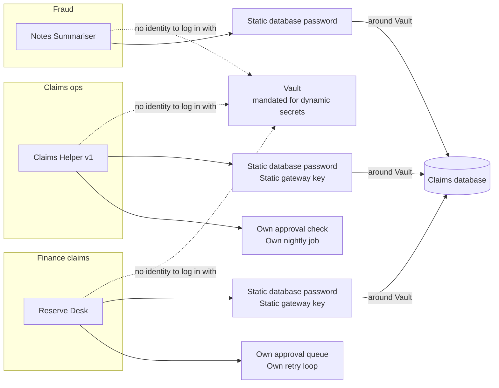
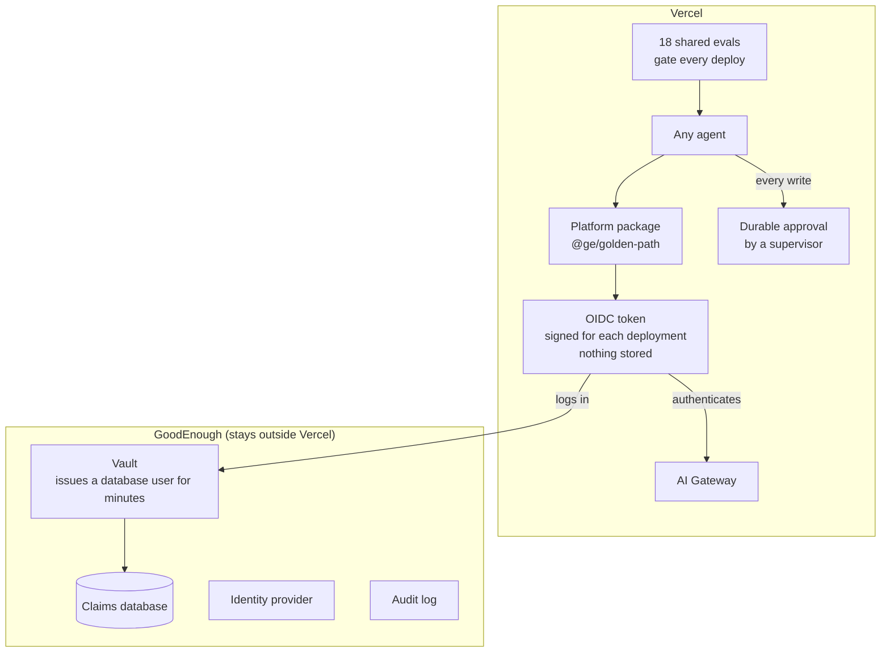

# One golden path for GoodEnough's AI agents

A proposal to put GoodEnough Insurance's AI agents on one reviewed path on Vercel, with a working
demo. GoodEnough is a fictional customer and all data in the demo is synthetic.

## 1. Problem statement

**Customer.** GoodEnough Insurance, a regional insurer. About 30 AI agents are in use or in
progress across claims operations, fraud and finance.

**Current stack.**
- Vault on AWS, mandated for dynamic database credentials.
- Postgres as the claims system of record.
- A corporate identity provider.
- Agents built team by team, mostly on the AI SDK inside each team's own app.

**Pain.**
- **Vault is mandated, but an agent has no way in.** To get a dynamic secret an agent must first
  prove who it is. Each team solves that alone, usually with another stored secret, so agents end
  up holding static database passwords and model keys.
- **Security reviews every agent from scratch.** Each has its own access rules, and some live only
  in a prompt.
- **Durable workflows are hard to build.** Teams hand-build approval queues and retry loops. A
  redeploy loses a pending approval, and a retry applies a change twice.
- **Writes are not really approved.** One agent accepts the word "approved" from anyone, including
  text inside a claim note, and records itself as the approver.
- **Nothing gates a release.** There are no evals, so a change that breaks a rule ships.

**Why it matters.** Every new agent repeats months of plumbing and waits on a bespoke security
review, so time to market is set by infrastructure, not by the idea. Meanwhile the agents already
live carry real exposure: standing credentials, policyholder identifiers reaching a model, and
writes nobody approved.

## 2. Current-state and target-state architecture

### Where Vercel fits: Connect, underpinned by Replace

| Role | Does it apply? | What it means here |
| --- | --- | --- |
| **Connect** | **Yes. This is the design.** | Agents hosted on Vercel securely use the systems that already matter to GoodEnough: Vault, the claims database, the identity provider. None of them moves. The connection is the deployment's own OIDC identity, so nothing is stored on either side. |
| **Replace** | **Yes. It is what makes Connect safe to repeat 30 times.** | Vercel takes the place of the layer every team was hand-building: approval queues, retry loops, nightly-job wrappers, model keys and routing, preview environments, and a release gate. None of that work is specific to insurance. |

Connect alone would leave each team to build the plumbing again, on a new host. Replace alone would
ask the customer to move systems it has good reason to keep. Together: the customer's systems stay
put, and the undifferentiated work between an agent and those systems is no longer each team's job.

**Current state.** Vault exists, and the agents go around it.

**Target state.** Every agent uses one platform package. The identity Vercel gives each deployment
is what opens Vault.

**What stays outside Vercel, and why.**

| Stays with GoodEnough | Why |
| --- | --- |
| Vault | It is the customer's root of trust and already mandated. It also needs a persistent disk and to be always on, which Vercel Functions are not. |
| Postgres | The system of record. No database credential is ever stored on the Vercel project; Vault issues one per step. |
| Identity | Who a user is, and whether they may approve, comes from the customer's directory. |
| Audit | Vault's audit log stays the record of who received which credential. Each agent step is tagged so the two can be joined. |

Only short-lived credentials and minimal query results cross the boundary. In production Vault and
Postgres sit in the customer's private network, reached through Secure Compute; in the demo they
have public TLS endpoints.

## 3. Vercel choices

| Primitive | What it does here | Why | Trade-off |
| --- | --- | --- | --- |
| **OIDC federation** | Vercel signs a token for every deployment. The agent logs in to Vault and AI Gateway with it. | Removes every standing secret, and the "how does my agent reach Vault" problem. | Vault must be configured to trust Vercel's issuer, once, and be reachable from Vercel. |
| **eve** (agent framework) | The golden-path agent: durable sessions, approvals, channels and evals. | A write that waits days for a person, with no approval queue to build. | Still a release candidate. Opinionated layout. Each eve agent is its own service, which counts against function limits. |
| **Vercel Workflow** | Runs each conversation as a durable workflow. Also behind `WorkflowAgent`. | A pending approval survives restarts and redeploys. | Steps must be idempotent and their state serializable, which changes how tools are written. |
| **AI SDK** (`ToolLoopAgent`, `WorkflowAgent`) | The paths for agents that should not move to eve. | A read-only, one-request agent stays simple. An agent inside an existing app keeps its routes and UI. | Three paths to support, not one. The advisor's rubric decides which. |
| **AI Gateway** | One endpoint for every model, authenticated by the deployment. | No model keys to issue, rotate or leak. | One more hop, and a dependency on the gateway's model catalogue. |
| **Preview deployments and Deployment Checks** | Every push gets a deployment. The eval suite runs against it and is a required check before promotion. | A build that breaks a rule cannot reach production. | Adds minutes to each release. Three of the evals are graded by a model, so they can vary. |
| **Deployment Protection with Trusted Sources** | Previews are private. CI and the advisor reach them by proving identity, not with a bypass secret. | The eval runner stores nothing. | More moving parts when something is refused. |

Also used: Vercel Connect (a GitHub App for the migration advisor, with no stored key), the eve
sandbox (legacy code is read there and never run), and the Marketplace (Neon Postgres).

## 4. Working demo

- **Live:** https://claims-agent-eve.vercel.app
- **Repository:** https://github.com/cmylchan/goodenoughinsurance-eve-migration-demo
  (four pull requests were squash-merged; their original commits are on each pull request's
  Commits tab, linked from the README's [Commit history](../README.md#commit-history))

The sign-in page lists the two test users. The Demo Guide in the chat (the compass button) runs
both demos step by step:

1. **A durable golden-path agent.** An adjuster asks to flag a claim; the agent stops for a
   supervisor, who approves by link or by text; the flag is written and both names are recorded.
2. **Migrating legacy agents.** Three agents built the old way fail in front of you. An AI advisor
   scores one, recommends a path, and opens the pull request that moves it.

## 5. Rollout plan

One agent at a time, read-only agents first. Each migration is one pull request.

| Stage | What happens | Exit test |
| --- | --- | --- |
| **Preview** | The migration PR adds the migrated agent beside the legacy one. Its preview deployment reads the test database only. | Both agents answer the same prompts on the preview. |
| **Validation** | The same 18 cases score the legacy and the migrated agent. Security reviews one Terraform block. A supervisor approves a real write. | Migrated agent passes every case. Security signs off. |
| **Canary** | Promote behind a Rolling Release, starting with a small share of traffic, or route one pilot team to the new agent. | No increase in errors or refusals; approvals complete; no leftover database users. |
| **Cutover** | Promote to all traffic. Disable the legacy agent's routes. | A full business day with no fallback to legacy. |
| **Rollback** | Instant Rollback to the previous deployment. Pending approvals are durable, so they are not lost. The legacy agent's static role is disabled, not dropped, for two weeks. A kill switch in the database stops all writes at once. | Rollback rehearsed on the preview before cutover. |

After cutover: drop the legacy role, delete its secrets, and remove the legacy code.

## 6. Success measures

The technical baselines are what the three legacy agents in the demo do today. GoodEnough is
fictional, so the business baselines are **assumptions for a regional insurer of this size**: the
first week of the engagement replaces them with the customer's own numbers, and the targets are then
agreed with them.

**Technical**

| Measure | Today (legacy agents) | Target (golden path) | How it is measured |
| --- | --- | --- | --- |
| Standing secrets held by agents | 4 (3 database passwords, 1 model key shared by 2 agents), never rotated | 0 | Count of secret-valued variables on agent projects |
| Lifetime of a database credential | Indefinite | Revoked at the end of each step; 5-minute default and 10-minute ceiling as backstops; none while a write waits | Vault lease TTLs and audit log |
| Writes with a named requester and a different named approver | 0% (Claims Helper records itself) | 100% | `claim_flags.requested_by` ≠ `approved_by` |
| Pending approvals lost across a deploy | All (Reserve Desk holds them in memory) | 0 | Approve-after-redeploy test each release |
| Evals passed before promotion | No gate | 18 of 18, required check | Deployment Check status |
| Database users left after a step | Not tracked | 0, with an alert above 0 | Count of Vault-issued roles in Postgres |

**Business**

| Measure | Assumed baseline | Target | How it is measured |
| --- | --- | --- | --- |
| Time from an agent idea to production | About 12 weeks, mostly plumbing and review | 3 weeks | First commit to first production promotion |
| Security review per agent | About 3 weeks, from scratch each time | 3 working days: one Terraform block, shared evals | Review ticket opened to approved |
| Engineering time spent on plumbing per agent | About 6 engineer-weeks | Under 1 week | Team estimates at each migration retro |
| Agents on the golden path, out of about 30 | 0 | 10 within two quarters, all 30 within a year | Agents whose project uses `@ge/golden-path` |
| Incidents involving agent credentials, unapproved writes or exposed policyholder identifiers | Taken from the incident log in week one | 0 on migrated agents | Incident log, tagged by agent |

The business case rests on the first two rows: if 30 agents each save about 9 weeks of delivery
time and 2 to 3 weeks of security review, the platform pays for itself well before the last
migration.

## 7. Known limitations and risks

What I would tell the customer before kickoff.

- **eve is a release candidate.** Plan for API changes, and keep the AI SDK paths available.
- **Short-lived credentials need watching.** During the build, a faulty revoke statement left
  every database user behind until Postgres refused new ones, and every agent failed closed. The
  fix is in; a monitor on leftover users belongs in the rollout.
- **Evals reduce risk; they do not remove it.** Models vary run to run. The gate caught none of
  four faults found by a person using the preview, because it checks what the agent says and
  writes, not credentials, sessions or ordering.
- **The advisor proposes; people decide.** Its pull requests are drafts, opened after approval, and
  it cannot merge. Its last two steps need a GitHub App and a trusted-source rule to be set up.
- **Cost and limits are not modelled.** The demo runs on a small plan; function counts, model spend
  and Vault capacity need sizing for 30 agents.

## 8. Development tooling

**What was used to build it.** Claude Code, Anthropic's coding agent, in cloud sessions working
against this repository. It wrote the code, the infrastructure and the documents. A person
directed the work, used every preview, and ran the commands that needed access to Vault, the
database or Vercel.

**How AI behaviour was validated.**

| Check | What it is | When it runs |
| --- | --- | --- |
| **Test set** | 18 shared cases for any claims agent: reads never write (5), writes ask first (3), scope (3), injection (2), minimisation (2), quality (3). One more covers approval by text. | Every deployment. |
| **Rubric** | The three quality cases are graded by a judge model against written levels and a pass threshold: concise, matches the seeded data, states its assumptions. | Every preview. |
| **Regression gate** | The suite is a required Deployment Check. A failing build cannot be promoted. | Before every promotion. |
| **Before and after** | The same cases score a legacy agent and its migrated version, side by side. | Each migration. |
| **Advisor's own evals** | Seven cases: the right verdict for each legacy agent, no PR without approval, a planted comment in the code is ignored, and it asks when the code is silent. | Advisor changes. |
| **Manual review** | Two people's roles played side by side on each preview. Findings are kept in [the build log](BUILD_LOG.md). | Every change. |

The manual review earned its place. It found a credential leak that took production down, two
users sharing one chat, a message thread sorted wrongly, and a write with no way to see it. None
was a failing eval. The build log records each one, and the checks that would have caught them are
the next evals to write.
