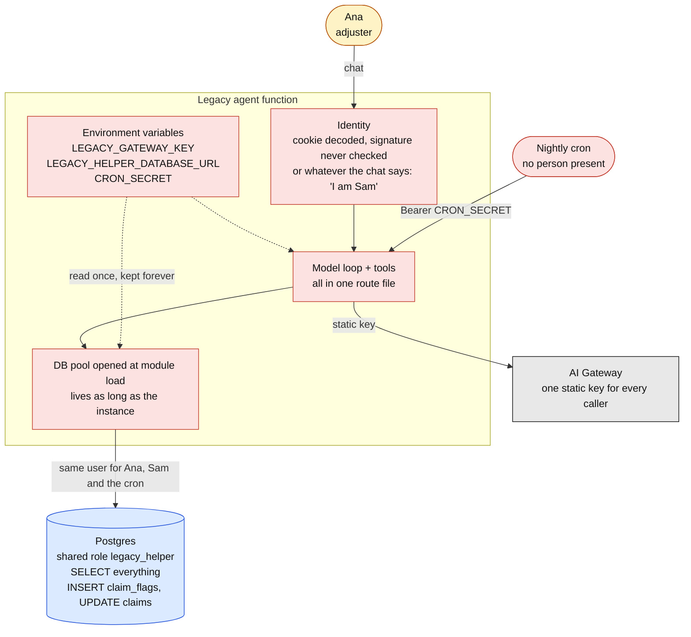
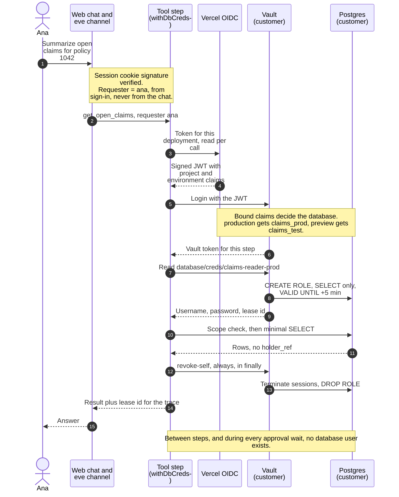
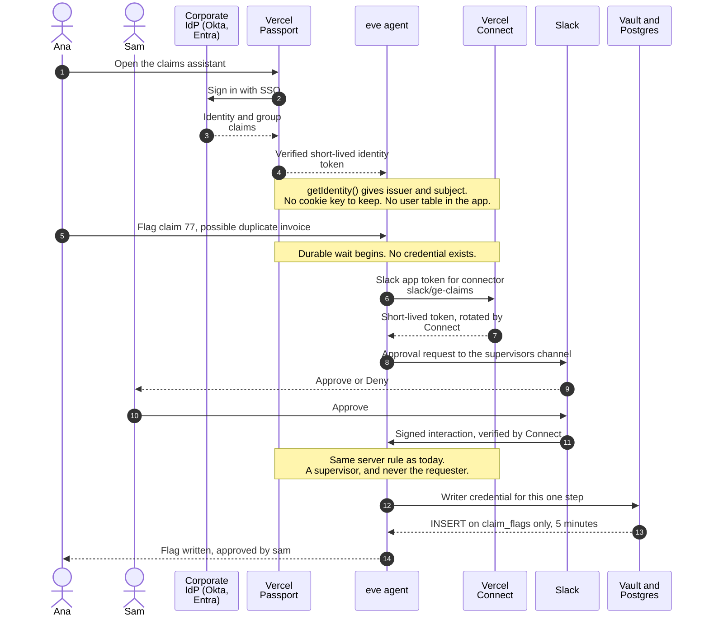
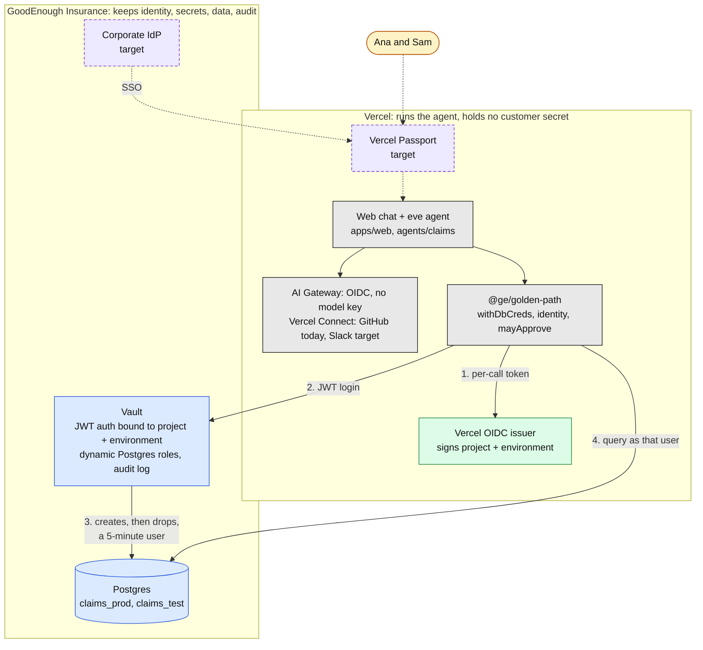
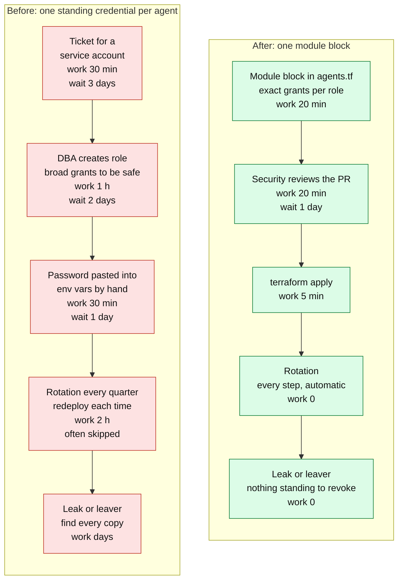

# 1. Auth flows: from standing secrets to credentials that live for one step

**The point to land:** a legacy agent is a process that holds keys. A golden-path agent holds
nothing. It proves which deployment it is, gets a credential for one tool step, and the credential
is gone before the step returns.

[Back to the index](README.md)

| Diagram | Use it to show |
|---|---|
| [Before](#before-standing-credentials) | Where the secrets sit, and who can use them |
| [After, as built](#after-as-built-nothing-to-steal) | The per-step credential flow that runs today |
| [After, target](#after-target-passport-and-connect) | Passport and Connect closing the last two gaps |
| [Components](#components) | Who owns what, and what crosses the boundary |
| [Value stream](#value-stream-giving-an-agent-data-access) | What the change is worth |

## Before: standing credentials

Source: [`legacy/claims-helper/route.ts`](../../legacy/claims-helper/route.ts),
[`legacy/claims-helper/sweep.ts`](../../legacy/claims-helper/sweep.ts).

**What to say**

- Three secrets never expire and are never rotated. Anyone who can read the project's environment,
  a build log or a memory dump has them.
- The database role can do everything the agent could ever need, all the time, including while a
  prompt injection is steering the model.
- The agent does not know who is asking. It decodes the login cookie without checking the
  signature, then lets the conversation overrule it.

## After, as built: nothing to steal

Source: [`packages/golden-path/src/vault.ts`](../../packages/golden-path/src/vault.ts),
[`infra/terraform/vault/modules/agent-db-access/main.tf`](../../infra/terraform/vault/modules/agent-db-access/main.tf).

**What to say**

- The only things in the project's environment are two addresses and the login stand-in's signing
  key. There is no `DATABASE_URL` and no model key.
- Vault, not application code, picks the database. A preview deployment cannot get a production
  credential even if the code asks for one.
- Models are reached the same way: AI Gateway accepts the deployment's OIDC token. GitHub is
  reached through a Vercel Connect app token. CI proves itself with GitHub's OIDC token.
- Run `infra/watch-leases.sh` on a second screen. A lease appears when a step starts and disappears
  when it ends.

## After, target: Passport and Connect

**Not built yet.** Two stand-ins remain in the demo: the login page (a mock IdP whose cookie key is
a standing secret, `MOCK_IDP_SIGNING_KEY`) and the simulated phone. This is the design that removes
both. Dashed purple boxes are new.

**What changes against today**

| Today | Target | Standing secret removed |
|---|---|---|
| Login page signs its own cookie | Passport authenticates against the corporate IdP before the request reaches the deployment | `MOCK_IDP_SIGNING_KEY` |
| Directory of two users in `identity.ts` | IdP groups arrive as claims; `canApprove` becomes a group check | The in-app password hashes |
| Simulated phone with a 6-digit code | Slack channel with `connectSlackCredentials`; no `SLACK_BOT_TOKEN` or signing secret in the project | None added, which is the point |
| GitHub through Connect (already built) | Unchanged | Already none |

**Open design point to settle before building:** the approver in Slack must map to the same
corporate identity Passport issues, so `mayApprove` compares like with like. Passport needs an
Enterprise plan.

## Components

Only two things cross the boundary: a short-lived credential going one way and minimal query
results coming back.

## Value stream: giving an agent data access

> **The times are illustrative planning figures, not measurements.** Replace them with the
> customer's own numbers before presenting. The steps and the handoffs come from the repo.

| Measure | Before | After | Source |
|---|---|---|---|
| Credential lifetime | Never expires | 5 minutes at most, usually seconds | `db_default_ttl_seconds = 300`, revoked in `finally` |
| Standing agent secrets in the project | 3 per legacy agent | 0 | README, "Named exceptions" |
| Lead time to first access | About 6 days, mostly waiting | About 1 day | Illustrative |
| Rotation effort per agent per year | About 8 hours | 0 | Illustrative |
| Reach of a stolen credential | Every table, both verbs, indefinitely | One verb on named tables, for minutes | `agents.tf` grants |
| Wrong-environment access | Depends on which string was pasted | Refused by Vault on a claim Vercel signs | `bound_claims` |
