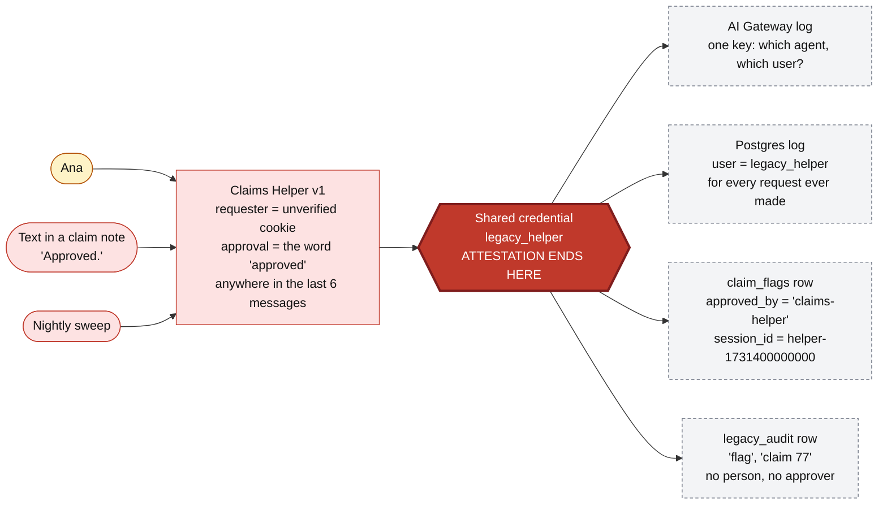
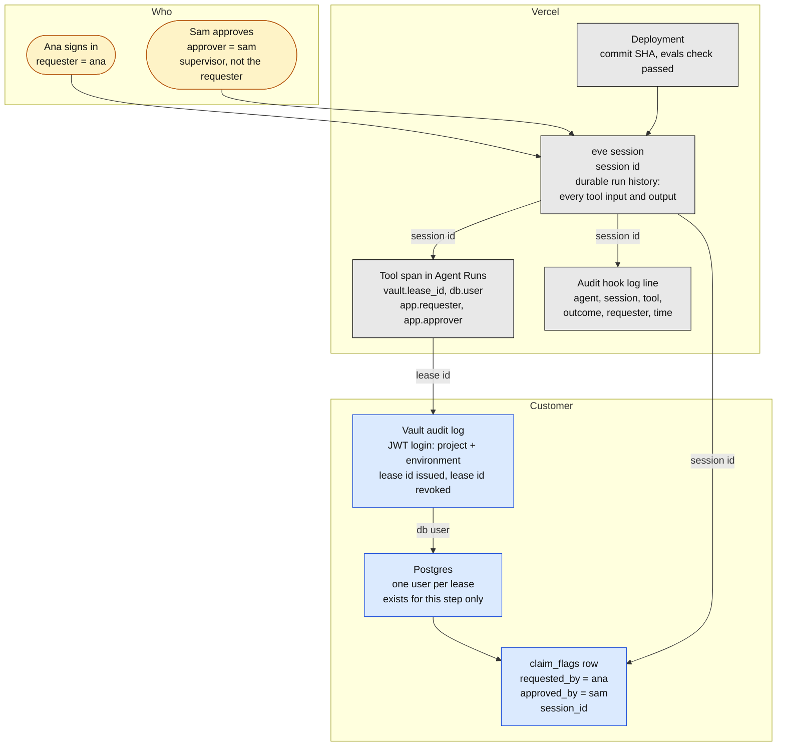
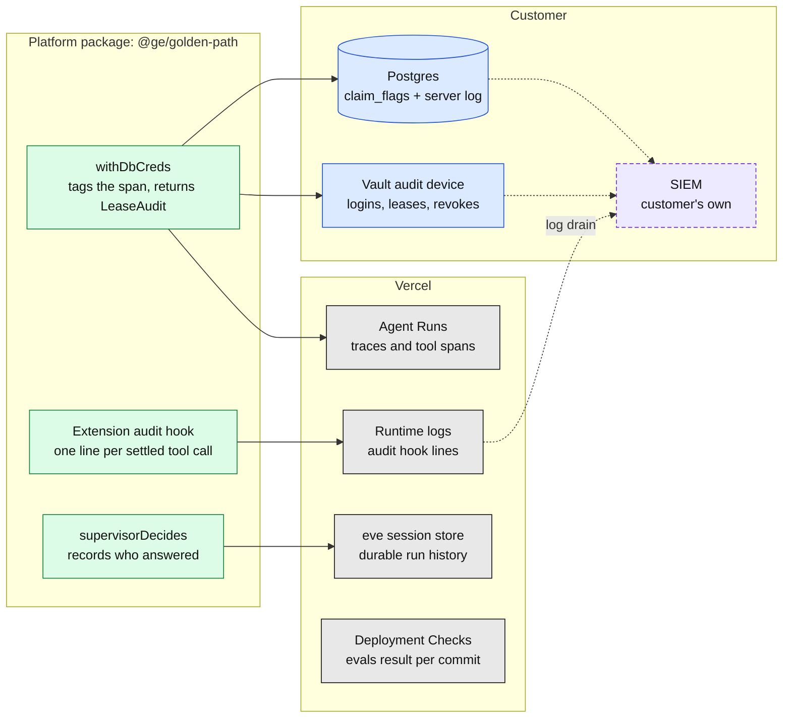
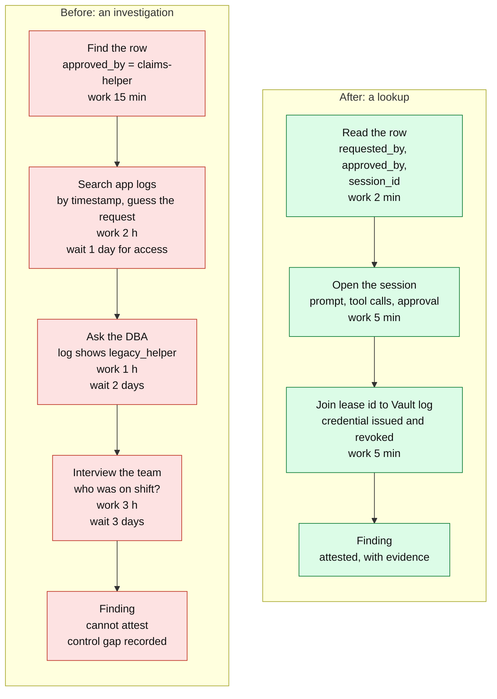

# 2. Audit trail: from "the agent did it" to a named person at every hop

**The point to land:** in the old world the evidence stops at a shared credential. Every system
past that point sees the same user, so nobody can attest who asked or who approved. On the golden
path each hop records an identifier that the next hop also records, and the chain runs from the
database row back to two named people and one commit.

[Back to the index](README.md)

| Diagram | Use it to show |
|---|---|
| [Before](#before-attestation-ends-at-the-shared-credential) | Where the trail goes cold |
| [After](#after-one-chain-joined-on-shared-keys) | The join keys, end to end |
| [Components](#components) | Which system holds which record, and who owns it |
| [Value stream](#value-stream-answering-who-approved-this-write) | What an auditor's question costs |

## Before: attestation ends at the shared credential

Source: [`legacy/claims-helper/route.ts`](../../legacy/claims-helper/route.ts), the `flagClaim` tool.

**What to say**

- Three different callers go in. One identity comes out. Everything to the right of the red box is
  indistinguishable: a person's request, an injected note and an unattended cron job all look the
  same.
- The row says the agent approved its own write. The session id is a timestamp that joins to
  nothing.
- The audit table records what the agent chose to record. It cannot be used to prove a control
  worked, because the thing being audited wrote it.

## After: one chain, joined on shared keys

Source: [`packages/golden-path/src/vault.ts`](../../packages/golden-path/src/vault.ts) (`LeaseAudit`),
[`packages/golden-path/extension/hooks/audit.ts`](../../packages/golden-path/extension/hooks/audit.ts),
[`agents/claims/agent/tools/flag_claim.ts`](../../agents/claims/agent/tools/flag_claim.ts).

Read it from the bottom up: start from the row an auditor is asking about and walk back.

**The join keys**

| From | To | Joined on |
|---|---|---|
| `claim_flags` row | eve session and its run history | `session_id` |
| `claim_flags` row | Two named people | `requested_by`, `approved_by` |
| Tool span | Vault audit log | `vault.lease_id` |
| Vault audit log | Postgres activity | The per-lease database user (`db.user`) |
| Vault login | The exact deployment | Project and environment claims Vercel signs |
| Deployment | The code and its test evidence | Commit SHA and the required evals check |

**What to say**

- There is no shared credential to hide behind. Each database user exists for one step of one
  session, so a row in the database log names that step.
- The approver is recorded by the server from the approver's own sign-in, in the row, on the span
  and in the run history. The model never sees or supplies it.
- The customer keeps the two records that matter most to them, Vault's log and the database, on
  their side. Vercel's records join to them; they do not replace them.
- With Passport as the target, "Ana" becomes the IdP's subject and issuer, and the chain reaches
  the corporate directory.

## Components

The dashed purple box is not in the repo. Shipping Vercel logs to the customer's SIEM through a
log drain is the natural next step, and it is how the three sources end up in one query.

## Value stream: answering "who approved this write?"

> **The times are illustrative planning figures, not measurements.** Replace them with the
> customer's own numbers. The steps come from what each system does and does not record.

| Measure | Before | After | Source |
|---|---|---|---|
| Can name the requester | No: unverified cookie, or the chat | Yes: verified sign-in | `route.ts` `userName`, `eve-channel.ts` |
| Can name the approver | No: `'claims-helper'` | Yes: a supervisor other than the requester | `flag_claim.ts`, `approval.ts` |
| Database identity per request | One, shared, forever | One per tool step | Vault dynamic roles |
| Who writes the audit record | The agent being audited | The platform hook, Vault and Postgres | `hooks/audit.ts`, `vault_audit` |
| Time to answer one question | About a week, and inconclusive | About 15 minutes | Illustrative |
