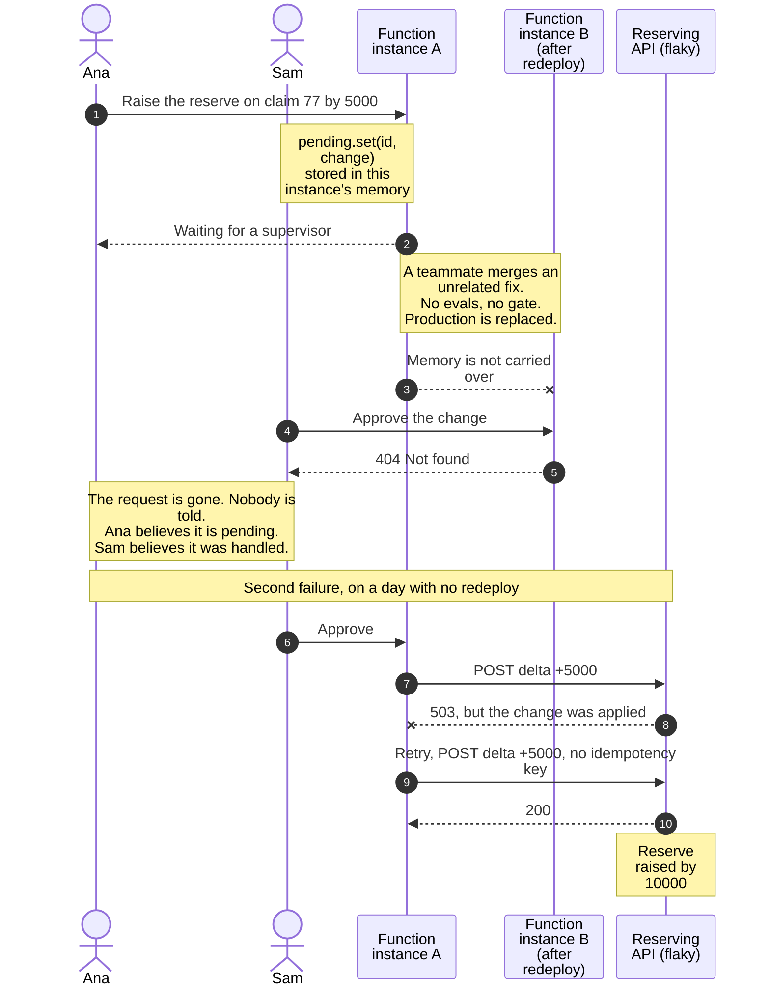
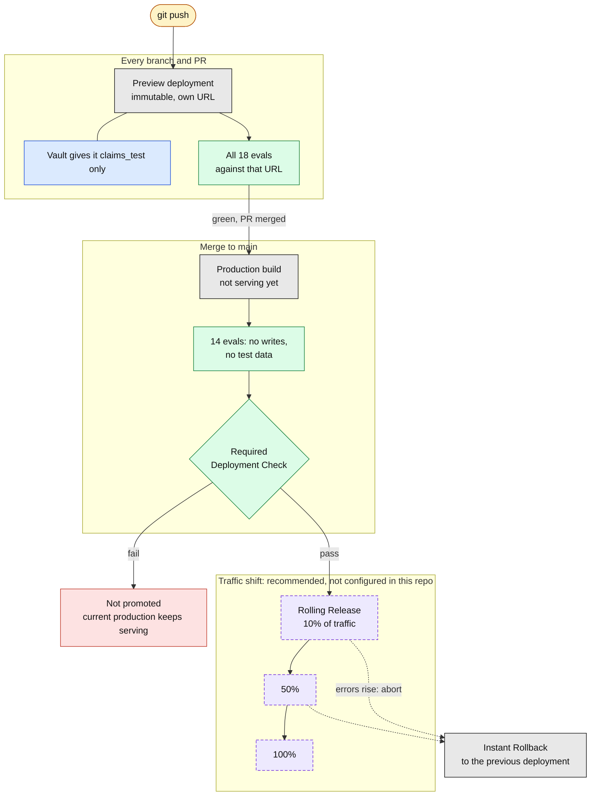
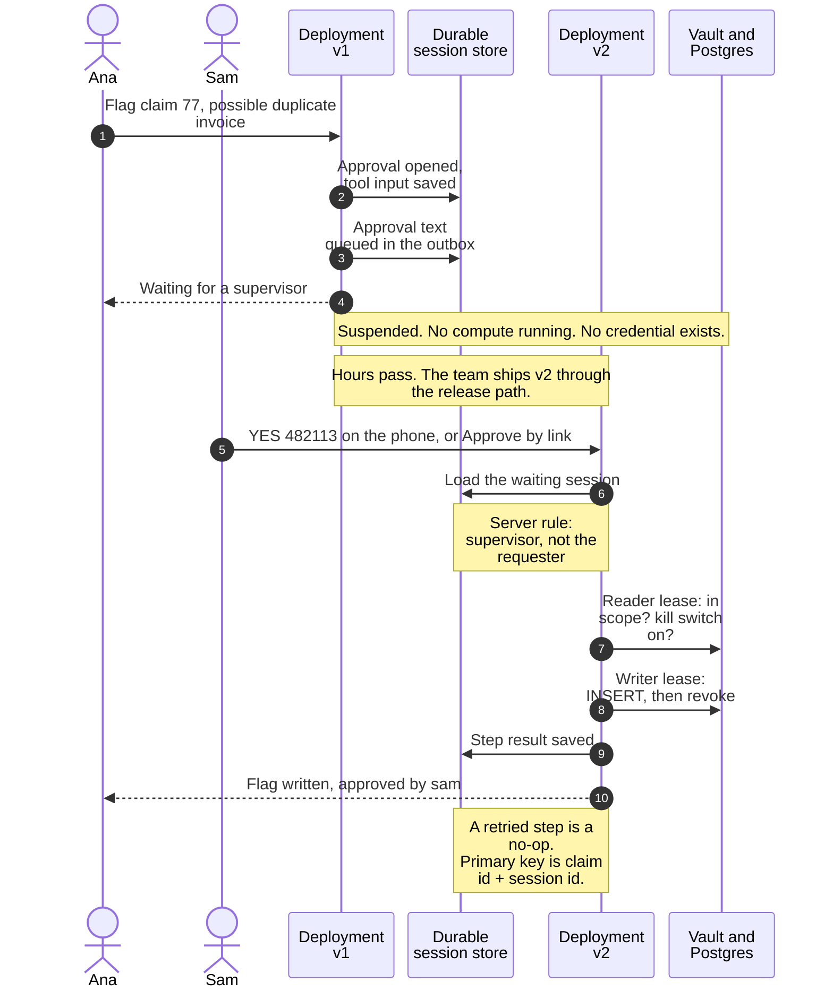
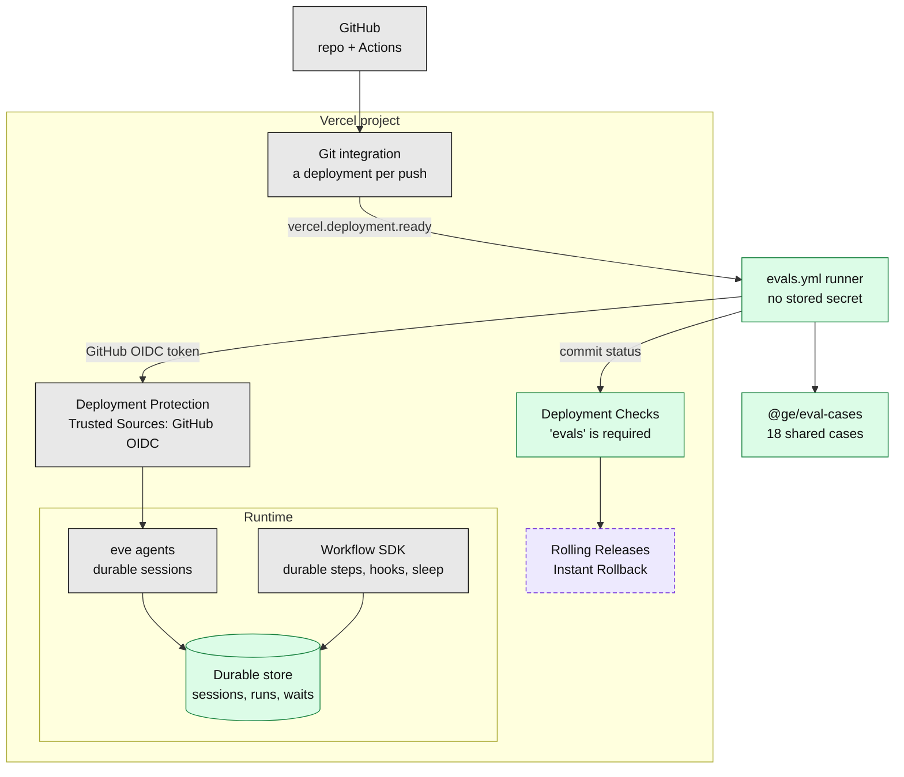
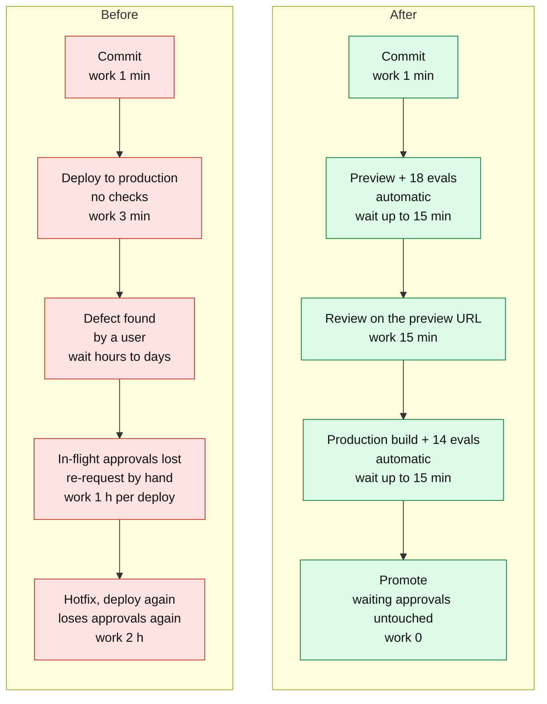

# 3. Deployment: gated rollouts, and approvals that outlive a redeploy

**The point to land:** two separate problems. First, nothing stood between a commit and
production. Second, a deployment used to destroy work in flight: an approval waiting on a
supervisor lived in the memory of a function instance, and the next deploy erased it. The golden
path gates the rollout on evals, and keeps the wait in durable storage so a deploy cannot touch it.

[Back to the index](README.md)

| Diagram | Use it to show |
|---|---|
| [Before](#before-ship-and-hope-and-the-approval-is-dropped) | The dropped approval and the double apply |
| [After: the release path](#after-the-release-path) | How a rollout should happen |
| [After: the durable wait](#after-the-durable-wait) | The approval surviving a redeploy |
| [Components](#components) | What makes up the gate |
| [Value stream](#value-stream-commit-to-production) | What the gate costs and saves |

## Before: ship and hope, and the approval is dropped

Source: [`legacy/reserve-desk/desk.ts`](../../legacy/reserve-desk/desk.ts) (`pending` is a
module-level `Map`; `applyReserveChange` retries with no idempotency key).

**What to say**

- Deploying is the most routine thing a team does, and here it silently deletes business work.
  The same loss happens on a cold start or when the approval lands on a different instance.
- Any signed-in user can approve, including the requester. That is a separate defect, shown in
  the auth and audit diagrams.
- Nothing checks the build before it serves traffic.

## After: the release path

Source: [`.github/workflows/evals.yml`](../../.github/workflows/evals.yml), README "Evals and the
release gate". Built and enforced today, except the staged traffic shift, which is dashed purple.

**What to say**

- The evals run against the real deployment URL, signed in as the test users, and the result is a
  required check. A build that fails cannot be promoted. That is rule 3, enforced by the platform.
- The CI runner stores no secret. It proves itself with GitHub's OIDC token, which Deployment
  Protection accepts through a Trusted Sources rule.
- Previews can only reach test data, because Vault binds the credential to the environment claim.
- **Recommended next step:** Rolling Releases shift production traffic in stages with a manual or
  timed advance, and an abort returns everyone to the previous deployment. The repo does not turn
  this on; say so if asked.

## After: the durable wait

Source: [`agents/claims/agent/tools/flag_claim.ts`](../../agents/claims/agent/tools/flag_claim.ts)
(`approval: always()`), [`agents/claims/agent/channels/eve.ts`](../../agents/claims/agent/channels/eve.ts)
(approval text outbox).

**What to say**

- The wait is a row in durable storage, not a variable in a process. A redeploy, a cold start or a
  different instance all read the same row.
- Nothing is held open while waiting: no function, no connection, no credential. The write
  credential is minted only after approval and lives for that one step.
- The kill switch is read after approval, so flipping it stops requests that were already waiting.
- Retries are safe by construction. For Reserve Desk the migrated `WorkflowAgent` sends an
  idempotency key, so "applied, then 503" applies once.
- Live proof for Reserve Desk: the `reserve-approval-survives-restart` eval clears in-memory state
  between request and approval. The legacy agent fails it; a durable agent passes.

**Verified so far:** the wait survives a restart locally (SPEC, Phase 0 spike). The same check on a
Vercel preview for the `WorkflowAgent` path (approve, redeploy mid-wait, resume) is still listed as
open in [`docs/SPEC.md`](../SPEC.md). Run it before claiming it on stage for that path.

## Components

## Value stream: commit to production

> **The times are illustrative planning figures, not measurements.** Replace them with the
> customer's own numbers. The 15-minute ceiling on the evals job is from `evals.yml`.

| Measure | Before | After | Source |
|---|---|---|---|
| Checks between commit and users | 0 | 18 on preview, 14 on the production build | `evals.yml` |
| Who finds a regression | A user, in production | The gate, before promotion | Required Deployment Check |
| Approvals lost per deploy | All that were waiting | 0 | `pending` Map vs durable session |
| Safe time to deploy | When nothing is pending, so in practice a freeze window | Any time | Follows from the above |
| Double-applied writes on retry | Possible on every 503 | None: idempotent step | `desk.ts` retry loop vs primary key and idempotency key |
| Added lead time per change | None, the cost arrives later | About 30 minutes of machine time | Illustrative |
