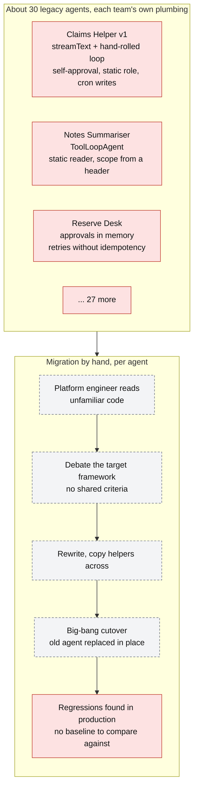
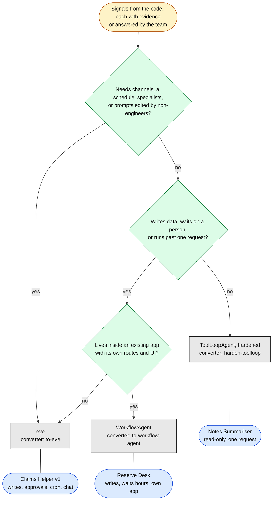
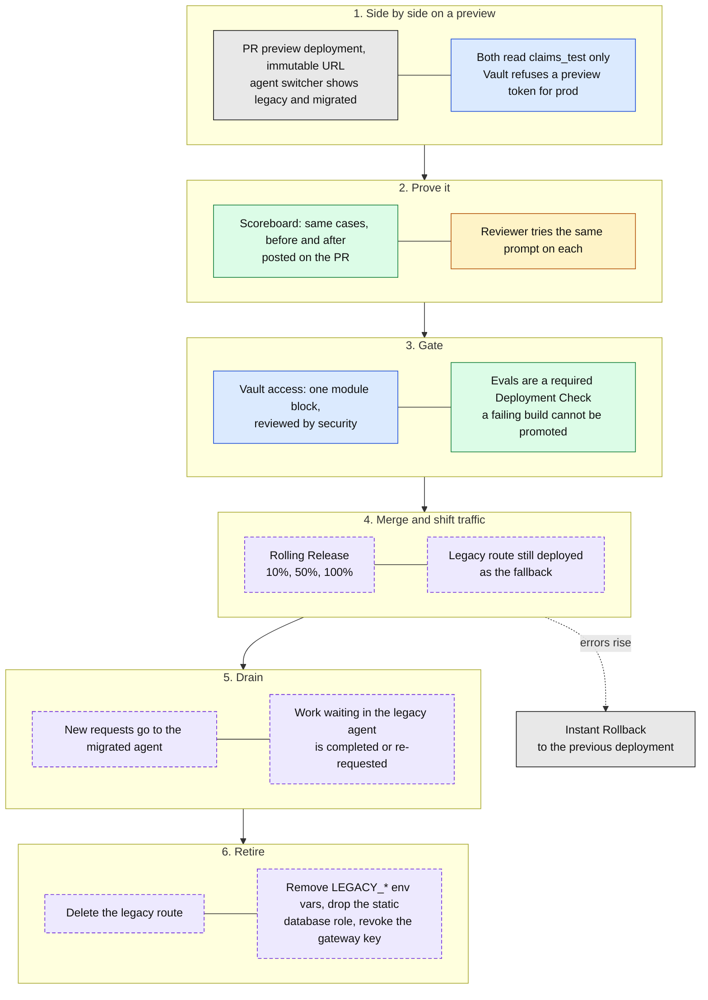
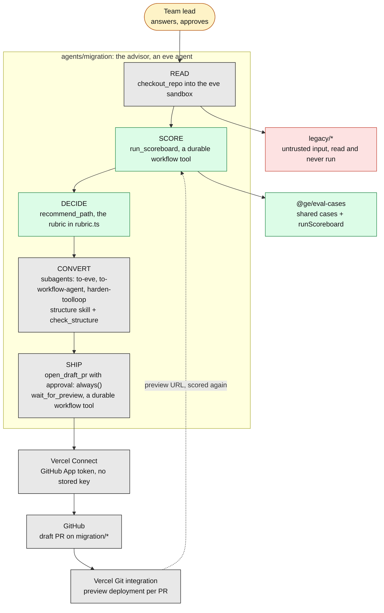
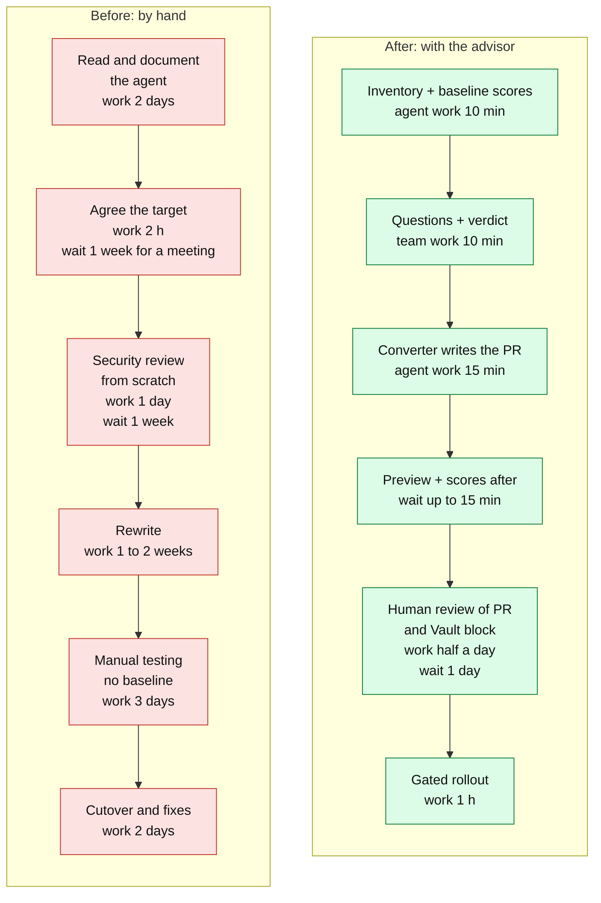

# 5. Migrating legacy agents safely

**The point to land:** the migration is itself a governed, durable agent workflow. AI does the
reading, scoring and rewriting. A deterministic rubric picks the path. People approve the verdict
and the pull request. Vercel's deployment model means the new agent is proven beside the old one,
on test data, before any production traffic moves.

[Back to the index](README.md)

| Diagram | Use it to show |
|---|---|
| [Before](#before-thirty-agents-thirty-rewrites) | Why hand migration does not scale |
| [After: the guided workflow](#after-the-guided-workflow) | The seven steps and where people decide |
| [Choosing the path](#choosing-the-path) | That the advisor does not sell eve |
| [Safe rollout](#safe-rollout-vercel-deployment-strategy) | Preview, gate, staged cutover, retire |
| [Components](#components) | What the advisor is made of |
| [Value stream](#value-stream-migrating-one-agent) | Cost per agent, times thirty |

## Before: thirty agents, thirty rewrites

**What to say**

- Every agent has a different mix of defects, so there is no single rewrite recipe.
- Without a shared eval suite there is no way to say the new agent is at least as good as the old
  one. The migration becomes a matter of opinion.
- The bottleneck is the platform team's attention, and it does not scale to thirty.

## After: the guided workflow

Source: [`agents/migration/agent/instructions.md`](../../agents/migration/agent/instructions.md).
Yellow is a person deciding. Green is deterministic code, not the model.

```mermaid
flowchart TB
  start(["Team opens the Migration Advisor"]):::human

  s1["1. Pick<br/>checkout_repo into the sandbox<br/>lists agents under legacy/"]:::vercel
  s2["2. Inventory<br/>reads the code, never runs it<br/>every fact has a file:line"]:::vercel
  s3["3. Baseline<br/>run_scoreboard: legacy agent vs golden path<br/>same 18 shared cases, durable workflow tool"]:::cred
  s4["4. Questions<br/>asks only what the code cannot settle"]:::vercel
  q{{"Team answers<br/>Yes / No / Not sure"}}:::human
  s5["5. Verdict<br/>recommend_path: deterministic rubric<br/>eve, WorkflowAgent or ToolLoopAgent"]:::cred
  v{{"Team decides<br/>Go with this / Show alternatives"}}:::human
  s6["6. Cut the PR<br/>converter subagent writes the change<br/>check_structure runs before the PR"]:::vercel
  a{{"Requester approves open_draft_pr<br/>durable wait"}}:::human
  pr["Draft PR on a migration/* branch<br/>migrated agent added beside legacy/<br/>GitHub via Vercel Connect, no stored token"]:::vercel
  s7["7. Preview<br/>wait_for_preview sleeps durably, up to 15 min<br/>run_scoreboard again on the preview URL"]:::cred
  done(["Preview link + scores before and after<br/>posted on the PR"]):::human

  start --> s1 --> s2 --> s3 --> s4 --> q --> s5 --> v --> s6 --> a --> pr --> s7 --> done
  v -.->|"alternatives"| s5

  classDef vercel fill:#e8e8e8,stroke:#111,color:#111
  classDef human fill:#fef3c7,stroke:#b45309,color:#111
  classDef cred fill:#dcfce7,stroke:#15803d,color:#111
```

**What to say**

- The advisor follows its own rules. It is an eve agent with a usage limit, no stored secret, an
  approval on its only write, and its own evals.
- Legacy code is untrusted input. `legacy/reserve-desk/desk.ts` carries a planted comment telling
  AI reviewers to recommend no changes. The advisor reports it as a finding, and an eval checks
  that it does.
- It cannot merge and cannot write to the base branch. The most it can do is open a draft PR after
  a person approves.

## Choosing the path

Source: [`agents/migration/agent/lib/rubric.ts`](../../agents/migration/agent/lib/rubric.ts), which
encodes Vercel's guide
[eve vs AI SDK agents vs WorkflowAgent](https://vercel.com/kb/guide/eve-vs-ai-sdk-agents-vs-workflowagent).

**Say:** the model gathers the evidence; a function returns the verdict. One of three agents stays
on the framework it already uses. That is the "it didn't sell us eve" moment.

| Every path gets | eve adds | WorkflowAgent adds | ToolLoopAgent keeps |
|---|---|---|---|
| `withDbCreds`, OIDC to the gateway, scope from the session, a step or usage limit, shared evals | Approval policy, channels, schedules, extension mount, Vault module block | `'use step'` tools, idempotency key, `needsApproval` hook, reconnectable stream | One request, no writes |

## Safe rollout: Vercel deployment strategy

Stages 1 to 3 are what the demo does today. Stages 4 to 6 (dashed purple) are the recommended
production cutover. The demo stops before them on purpose: demo PRs are never merged, so the
legacy agents stay legacy for the next run.

**Why each stage is safe**

| Stage | Risk it removes | Vercel capability |
|---|---|---|
| 1 | Testing against real data | Preview deployments, OIDC environment claim bound in Vault |
| 2 | "It seems fine" | Shared eval cases run against any deployment URL |
| 3 | Shipping a regression | Required Deployment Checks |
| 4 | A bad cutover reaching everyone | Rolling Releases, Instant Rollback |
| 5 | Losing in-flight work | Durable sessions on the new side; drain needed only for the legacy side |
| 6 | Leaving the old keys lying around | Nothing to keep: the migrated agent has no standing secret |

**Stage 5 needs care, and only on the legacy side.** Legacy state lives in memory, so it cannot be
carried over. For Reserve Desk, clear the approvals screen before removing the route. This is the
last time a deployment can drop an approval.

## Components

## Value stream: migrating one agent

> **The times are illustrative planning figures, not measurements.** Replace them with the
> customer's own numbers, ideally from timing the advisor on their first real agent.

| Measure | Before | After | Source |
|---|---|---|---|
| Engineer effort per agent | About 3 weeks | About 1 day, mostly review | Illustrative |
| Calendar time per agent | About 5 weeks | About 2 days | Illustrative |
| Across 30 agents | About 90 engineer-weeks | About 6 engineer-weeks | Illustrative, 30 from the README |
| Evidence the new agent is better | Opinion | Scores on the same cases, before and after, on the PR | `run_scoreboard`, `comment_on_pr` |
| Framework decision | Per-team debate | One rubric, same answer every time | `rubric.ts` |
| Where people spend time | Reading and rewriting | Approving a verdict and reviewing a PR | Advisor instructions |
| Risk at cutover | Replace in place | Side by side, gated, reversible | Stages 1 to 4 above |
