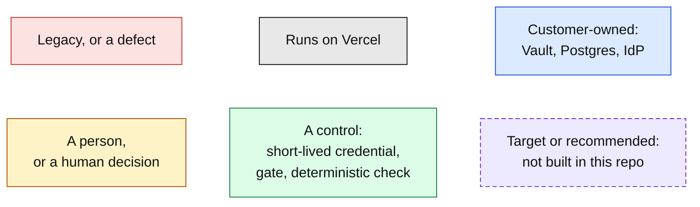

# Demo diagrams

Before-and-after diagrams for the GoodEnough Insurance demo. Every diagram is Mermaid in a fenced
block, so it renders on GitHub in light and dark mode with no build step.

Each use case has four kinds of diagram: the **before** architecture, the **after** architecture,
a **component** diagram, and a **value stream map** that puts a business number on the change.

| # | Use case | The one-line story | Diagrams |
|---|---|---|---|
| 1 | [Auth flows](01-auth-flows.md) | Standing secrets become credentials that live for one tool step | Before · After (built) · After (Passport + Connect target) · Components · Value stream |
| 2 | [Audit trail](02-audit-trail.md) | Attestation used to end at a shared credential; now every hop joins back to two named people | Before · After · Components · Value stream |
| 3 | [Deployment](03-deployment.md) | Gated rollouts, and approvals that survive a redeploy instead of being dropped | Before · Release path · Durable wait · Components · Value stream |
| 4 | [Agent demo commands](04-agent-demo-commands.md) | Four prompts, four controls, none of which depends on the model behaving | Map · Read · Write · Scope · Injection · Before/after · Components · Value stream |
| 5 | [Migration workflow](05-migration-workflow.md) | AI reads, scores and rewrites; a rubric decides; people approve; Vercel proves it side by side | Before · Guided workflow · Path rubric · Safe rollout · Components · Value stream |

## Colour key

The same colours mean the same thing in every diagram.

## What is built, and what is a target

Know this before presenting. Dashed purple boxes mark everything in the second column.

| Built and running in this repo | Target or recommended, not built |
|---|---|
| Vercel OIDC to Vault, 5-minute Postgres users, revoke on every step | **Vercel Passport** in front of the app, wired to the corporate IdP |
| AI Gateway through OIDC, no model key | **Slack approvals through Vercel Connect** (today the approval goes to a simulated phone) |
| GitHub through Vercel Connect (the migration advisor) | **Rolling Releases** for staged traffic shift |
| Durable approval on `flag_claim`, supervisor-only, by link or simulated phone | Log drain from Vercel to the customer's SIEM |
| Evals as a required Deployment Check | Production cutover and retirement of a migrated agent (demo PRs are never merged) |
| Migration advisor: seven steps, rubric, three converters, draft PR, preview scores | |

One more item to check before the day: for the `WorkflowAgent` path, [`SPEC.md`](../SPEC.md) lists
"approve, redeploy mid-wait, resume" on a Vercel preview as still open. It passed locally.

## About the numbers in the value stream maps

Facts taken from the repo are cited in each table's Source column (credential lifetime, eval
counts, timeouts, who is recorded as approver). **Durations for human work and waiting are
illustrative planning figures, not measurements.** They are there so the shape of the saving is
visible. Replace them with the customer's own figures before putting them in front of a buyer.

## Suggested order on stage

1. **[4. Agent demo commands](04-agent-demo-commands.md)**: run the four prompts live, with the
   map on screen.
2. **[1. Auth flows](01-auth-flows.md)**: explain why prompt 1 needed no secret. Show
   `infra/watch-leases.sh`.
3. **[2. Audit trail](02-audit-trail.md)**: take the row prompt 2 wrote and walk it back to Ana
   and Sam.
4. **[3. Deployment](03-deployment.md)**: redeploy while an approval is waiting.
5. **[5. Migration workflow](05-migration-workflow.md)**: "and here is how the other thirty get
   there."

## Editing

The diagrams are plain text. Edit the Mermaid block and GitHub re-renders it. To export an image
for slides, paste a block into https://mermaid.live and download SVG or PNG.
